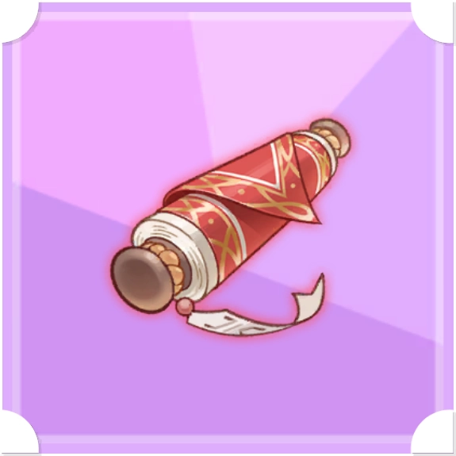
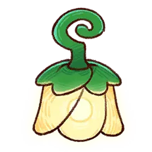
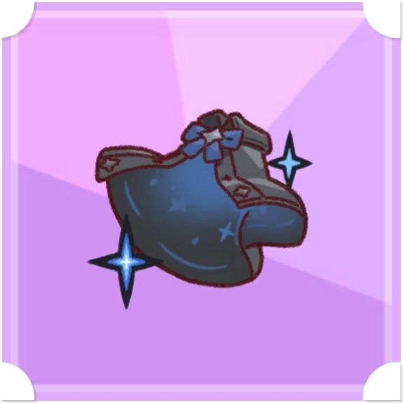
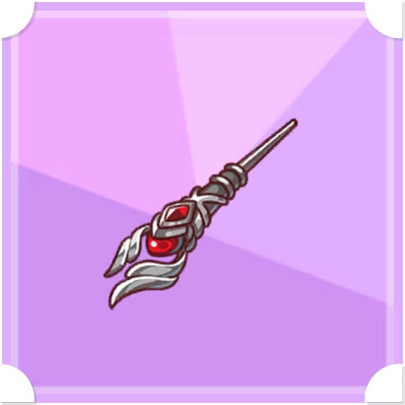
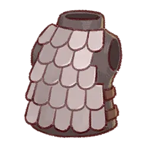
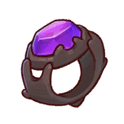
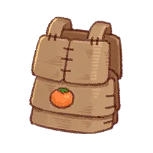
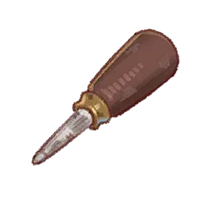

# 遺物カード

- 各スターアップ（俗に言う凸）状況によって数値は変動。
- わたしのデッキの数値を書き起こし。
- 2026年10月23日追加分は、[トリッカル・もちもちほっペ大作戦 Wiki* の遺物カード一覧](https://wikiwiki.jp/thetrickal/%E3%82%AB%E3%83%BC%E3%83%89/%E9%81%BA%E7%89%A9%E3%82%AB%E3%83%BC%E3%83%89)に掲載されたカードランクごとの範囲と愛用効果を書き起こし。

## 2026年10月23日追加分

| 画像 | アイテム名 | レアリティ | コスト | 説明 | 効果 | 愛用遺物効果 | 愛用使徒 | 愛用遺物か？ |
| :---: | --- | --- | ---: | --- | --- | --- | --- | --- |
|  | スノキーのフェドーラ | 伝説 | 18 | 攻撃速度増加 +11.3～22.5% HP増加 +18.8～37.5% 着用者のHPが50%以上の場合、最大HPが10%、防御力が20～38%増加する。 この効果はスタックしない。 | 攻撃速度11.3～22.5%増加 HP18.8～37.5%増加 最大HP10%増加 防御力20～38%増加 | Lv.1:普通攻撃を3回行うごとに、味方陣営から最も近い敵へ飛び蹴りを放ち、範囲物理ダメージを与えて一定確率で気絶させる。強化攻撃は一定確率でもう一度発動し、連続発動するたびに発動確率が減少する。 物理ダメージ:700% 気絶確率:50% 気絶の持続時間:2秒  Lv.3:スノキーの物理攻撃力、物理防御力、魔法防御力が9%増加する。 | スノキー | TRUE |
|  | セリーネの夜幻影 | 伝説 | 28 | 被会心率減少 +13.7～27.4% 会心被ダメージ量減少 +7.6～15.2% 着用者がスキルを使用すると、最大HPの12～24%を回復する。最大HPを超えた回復量は6秒間シールドに変換される。 この効果はスタックしない。 | 被会心率13.7～27.4%減少 会心被ダメージ量7.6～15.2%減少 最大HPの12～24%回復 | Lv.1:高学年スキル「チャンネルNo.5」で、残りHP割合が最も低い敵に範囲魔法ダメージを与える。その後、自身にシールドを生成し、被ダメージ量を減少させる。 魔法ダメージ:900～2160% シールド:最大HPの30～72% シールドの持続時間:8秒 被ダメージ量減少:30% 被ダメージ量減少の持続時間:8秒  Lv.3:セリーネの高学年スキルのクールタイムが10秒減少する。 | セリーネ | TRUE |
|  | キャロットのサトウキビ | 伝説 | 17 | 攻撃速度増加 +10.6～21.2% 防御力増加 +13.2～26.4% 戦闘開始時、着用者と同じ列にいる味方全員の1秒ごとのSP回復量を4～12増加させる。 同一の使徒が複数装着したカード効果はスタックしない。 | 攻撃速度10.6～21.2%増加 防御力13.2～26.4%増加 1秒ごとのSP回復量4～12増加 | Lv.1:低学年スキル「急成長の樹液発射」で、樹液を自身と最もHP割合が低い味方に落とす。範囲内の味方の攻撃力とHP回復量を増加させ、被ダメージ量を減少させる。 攻撃力増加:20～34% HP回復量増加:20% 被ダメージ量減少:31～45% 各効果の持続時間:8秒  Lv.3:キャロットのHP、物理防御力、魔法防御力が9%増加する。 | キャロット | TRUE |
|  | クロエの万能裁縫箱 | 伝説 | 30 | 攻撃速度増加 +19.7～39.4% 被会心率減少 +14.8～29.6% 着用者にシールドが付与されている場合、被ダメージ量が18～30%減少する。 この効果はスタックしない。 | 攻撃速度19.7～39.4%増加 被会心率14.8～29.6%減少 被ダメージ量18～30%減少 | Lv.1:普通攻撃の被ダメージ量が24～52%減少する。「ぬいぐるみの意志」発動中は2秒ごとに周囲へ魔法ダメージを与え、敵に最大5スタックの糸爆弾を付与する。最大スタック時に糸爆弾が爆発する。 魔法ダメージ:230% 糸爆弾魔法ダメージ:346%  Lv.3:クロエの魔法攻撃力、会心抵抗、会心ダメージ抵抗が9%増加する。 | クロエ | TRUE |
|  | リスティの模造グローブ | 伝説 | 19 | 攻撃力増加 +14.9～29.8% 会心ダメージ量増加 +8～15.9% 普通攻撃を6回行うごとに、12秒間会心率が18～30%増加する。 この効果はスタックしない。 | 攻撃力14.9～29.8%増加 会心ダメージ量8～15.9%増加 会心率18～30%増加 | Lv.1:3回攻撃するごとに敵をハッキングし、確定会心物理ダメージを与える。強化攻撃後、自身のSPを回復する。 物理ダメージ:240% SP回復量:60%  Lv.3:リスティの物理攻撃力、会心、会心ダメージが9%増加する。 | リスティ | TRUE |
|  | バロンの呪いのぬいぐるみ | 伝説 | 24 | 攻撃力増加 +19.3～38.5% 防御力増加 +19.3～38.5% 着用者が敵に状態異常を付与すると、6秒間、強化攻撃のダメージ量が50～76%増加する。 | 攻撃力19.3～38.5%増加 防御力19.3～38.5%増加 強化攻撃のダメージ量50～76%増加 | Lv.1:釘を飛ばして敵に3回魔法ダメージを与え、攻撃速度を減少させ、自身に目くらましを付与する。呪い状態の敵が存在する場合は基本攻撃の代わりに強化攻撃を発動する。 総魔法ダメージ:660% 攻撃速度減少:30% 攻撃速度減少の持続時間:5秒 目くらましの持続時間:8秒  Lv.3:バロンの魔法攻撃力、会心、会心ダメージが9%増加する。 | バロン | TRUE |
|  | ティグの燃え盛る剣 | 伝説 | 21 | 攻撃力増加 +16.6～33.3% 会心ダメージ量増加 +8.9～17.8% 普通攻撃3回ごとに着用者の攻撃速度が2～4%増加する（最大10回スタック）。 この効果はスタックしない。 | 攻撃力16.6～33.3%増加 会心ダメージ量8.9～17.8%増加 攻撃速度2～4%増加 | Lv.1:高学年スキル「オーバードライブ」で範囲物理ダメージを与え、攻撃速度と普通攻撃ダメージを増加させる。効果中、強化攻撃が命中すると火傷を付与し、火傷状態の敵へのダメージ量が増加する。 物理ダメージ:900～2160% 攻撃速度増加:200% 普通攻撃ダメージ増加:100% 効果の持続時間:10秒 火傷の持続時間:4秒 火傷状態の敵へのダメージ量増加:100%  Lv.3:ティグの物理攻撃力、会心、会心ダメージが9%増加する。 | ティグ | TRUE |
|  | ルードのトレーニング教本 | 伝説 | 19 | HP増加 +33% 着用者のHP回復量が30%増加する。 | HP33%増加 HP回復量30%増加 | Lv.1:4回攻撃するごとにポーズを決め、6秒間自身の被ダメージ量を30%減少させる。ポーズ終了後、自身のHPを最大HPの20%回復する。  Lv.3:ルードのHP、会心抵抗、会心ダメージ抵抗が9%増加する。 | ルード | TRUE |
|  | ロレットのマジックハット | 伝説 | 18 | 攻撃力増加 +14.1% 会心率増加 +14.1% 敵が3体以上の場合、着用者のスキルダメージ量が45%増加する。 この効果はスタックしない。 | 攻撃力14.1%増加 会心率14.1%増加 スキルダメージ量45%増加 | Lv.1:低学年スキル「歓声を浴びるエンターテイナー」で鳩を3体飛ばし、最も遠い敵に範囲魔法ダメージを与える。復活マジック後、自身のSPを回復する。 総魔法ダメージ:750～1800% SP回復量:100  Lv.3:ロレットの魔法攻撃力、会心、会心ダメージが9%増加する。 | ロレット | TRUE |
|  | ピラの輝く名刺 | 伝説 | 25 | HP増加 +26.9～53.7% 防御力増加 +20.1～40.3% 戦闘開始時、着用者と同じ列にいる味方全員の攻撃速度を16～48%増加させる。 同一の使徒が複数装着したカード効果はスタックしない。 | HP26.9～53.7%増加 防御力20.1～40.3%増加 攻撃速度16～48%増加 | Lv.1:3回目の攻撃ごとに富豪をランダムに失い、名刺を4枚投げる。名刺はランダムな敵に物理ダメージを与え、被ダメージ量を増加させる。 富豪最大減少:5 1回あたりの物理ダメージ:400% 被ダメージ量増加:44% 持続時間:6秒  Lv.3:ピラの高学年スキルのクールタイムが5秒減少する。 | ピラ | TRUE |
|  | シェルムの羊皮紙の巻物 | 伝説 | 25 | 会心率増加 +20.1% 会心ダメージ量増加 +10.7% 低学年・高学年スキルが直接ダメージで命中するたびに攻撃力が1%増加する（最大20回スタック）。最大スタック時、スキルダメージ量が30%増加する。 この効果はスタックしない。 | 会心率20.1%増加 会心ダメージ量10.7%増加 攻撃力1%増加 スキルダメージ量30%増加 | Lv.1:スキル「ウィッチ・ヘリテージ」で12秒間「伝承の帳」を作り、範囲内の味方の攻撃力を1秒ごとに増加させ、敵に13回範囲魔法ダメージを与える。ワールドボスには追加魔法ダメージを与える。 攻撃力増加:10～24% 攻撃力増加の持続時間:8秒 1秒ごとの魔法ダメージ:150～360% ワールドボスへの追加魔法ダメージ:150～360%  Lv.3:シェルムの魔法攻撃力、会心、会心ダメージが9%増加する。 | シェルム | TRUE |
|  | ライフジェム | 伝説 | 23 | HP増加 +24.5～49% 会心被ダメージ量減少 +6.1～12.2% 着用者のHPが40%以下になると、5秒以内に最大HPの80～112%を回復する。 この効果はスタックしない。 | HP24.5～49%増加 会心被ダメージ量6.1～12.2%減少 最大HPの80～112%回復 |  |  | FALSE |
|  | 30KGケトルベル | 伝説 | 22 | 会心率増加 +17.5～35% 会心ダメージ量増加 +9.3～18.7% スキルダメージ量が30～62%増加する代わりに、普通攻撃のダメージ量が40%減少する。 この効果はスタックしない。 | 会心率17.5～35%増加 会心ダメージ量9.3～18.7%増加 スキルダメージ量30～62%増加 普通攻撃ダメージ量40%減少 |  |  | FALSE |

| 画像 | アイテム名         | レアリティ （ガチャのときに影響するのみで、戦闘時のカード出現には影響しない） | コスト （戦闘時にカードを引いたときに支払うコスト） | 説明                                                                                                                     | 効果                                                             | 愛用遺物効果 （愛用使徒が使用したときのみの発揮される効果、重複しない）                                                                                                                                                                                                                                               | 愛用使徒     | 愛用遺物か？ |
| :---: |---------------|---------------------------------------------|--------------------------------|------------------------------------------------------------------------------------------------------------------------|----------------------------------------------------------------|----------------------------------------------------------------------------------------------------------------------------------------------------------------------------------------------------------------------------------------------------------------------------------------|----------|--------|
|  | 竜光剣 | 伝説                                          | 25                             | 攻擊力増加 +80.6% 着用者の攻撃速度が1秒ごとに5%増加する。低学年スキルを使用すると、この効果はリセットされる。 この効果はスタックしない。 使えば使うほど攻撃のスピートが速くなる不思議な剣。       | 最大★数効果 攻撃力80.6%増加 攻擊速度5%増加                             |                                                                                                                                                                                                                                                                                        |          | FALSE  |
|  | エレナの強化ドローン | 伝説                                          | 21                             | HP増加 +29.1% 攻擊力増加 +23.3% 着用者が低学年スキルを使用すると、6秒間攻撃速度が7.8%増加する。 この効果はスタックしない。                                  | HP29.1%増加 攻撃力23.3%増加 攻擊速度7.8%増加                        | 愛用遺物スキル:D-CATパルス波 Lv.1:強化された特殊ドローンを送った後、パルス波を周囲に放出して敵に8回の範囲物理ダメージを与え、気絶させる。 物理ダメージ:4340% 最後の爆破の物理ダメージ:1860% 気絶の持続時間:3秒  Lv.3:エレナの攻速度が100%増加する。 攻擊速度増加 +100%                                                                                                | エレナ      | TRUE   |
|  | エルダインランプ | 伝説                                          | 16                             | HP増加 +28.9% HP治癒量増加 +17.3% 特別な効果はないが、基本効果は手堅い。 世界樹の蕾の形をしたランプ。中から出てくるほのかな温もりに心が癒されるようだ。                     | HP28.9%増加 HP治癒量17.3%増加                                     |                                                                                                                                                                                                                                                                                        |          | FALSE  |
|  | シオンの黒マント | 伝説                                          | 25                             | 攻撃力増加 +28.2% 会心率増加 +15.9% 敵が1体しかいない場合、着用者のダメージ量が55%増加する。 この効果はスタックしない。                                     | 攻撃力28.2%増加 会心率15.9%増加 ダメージ量55%増加                       | 愛用遺物スキル:基本攻撃 Lv.1:弾丸を発射し、指定された射程距離内で最も離れている敵に物理ダメージを与える。 一定確率で強化の弾丸を発射し、より高い物理ダメージを与える。 物理ダメージ:200% 強化の弾丸物理ダメージ:444%  Lv.3:シオンの物理攻撃力、会心、会心ダメージが9%増加する。 物理攻擊力増加 +9% 会心ダメージ増加 +9% 会心増加 +9%                                                           | シオン・ザ・DB | TRUE   |
|  | ピコラのファッションポーチ | 伝説                                          | 23                             | 攻撃力増加 +23% HP治癒量増加 +18.4% 対象を回復させた場合、6秒間、回復させた対象の防御力を10%増加させる。 カード効果で発生する回復には発動しない。 この効果はスタックしない。      | 攻撃力23%増加 HP治癒量18.4%増加 防御力10%増加                         | 愛用遺物スキル:初回限定ステッカー 一定時間、残りHP割合が最も低い味方3名にステッカーを貼り、HPを回復させる。ステッカーは味方のHPを追加で回復させ、会心抵抗と物理防御力を増加させる。 ステッカーが貼られている間は、HPが継続的に回復する。 この効果は解除できない。  Lv.1:HP回復:攻撃力の1260% ステッカーのHP回復:対象の最大HPの23% 会心抵抗増加:22% 物理防御力増加:22% 1秒ごとのHP回復:対象の最大HPの12% ステッカーの持続時間:8秒 | ピコラ      | TRUE   |
|  | リッツのすり減った砥石 | 伝説                                          | 23                             | HP増加 +23%  防御力増加 +23%  普通攻撃で受けるダメージが40%減少する。 着用者の基本攻撃が2回命中するたびに最大HPの16.5%を回復する。 この効果はスタックしない。  | HP23%増加 防御力23%増加 最大HPの16.5%HP回復                        | 愛用遺物スキル:パッシブスキル Lv.1:目標の敵への与ダメージ量が増加し、目標の敵からの被ダメージ量が減少し、目標の敵への基本攻撃の与ダメージ量が増加する。 精錬の一撃で力を溜めている間、目標の敵からダメージを受けない。 ダメージ量増加:96% 被ダメージ量減少:36% 基本攻撃のダメージ量増加:100%                                                                                                         | リッツ      | TRUE   |
|  | バターのイエローカード | 伝説                                          | 22                             | 攻擊力増加 +21.9%  攻擊速度増加 +17.5% 着用者の強化攻撃ダメージ量が46.5%増加する。                                                       | 攻撃力21.9%増加 攻擊速度17.5%増加 強化攻撃のダメージ量46.5%増加               | 愛用遺物スキル:強化攻撃 Lv.1:味方が直接ダメージを受けると怒りを4回獲得し、100回になると強化攻撃が変更される。強化攻撃では銃を取り出し、範囲内の敵に確定会心物理ダメージを与える。 怒りはバターが倒された状態でも獲得でき、獲得した怒りは消えない。 直接ダメージ:状態異常ダメージ、反射ダメージを除いた直接攻撃によるダメージを意味する。 物理ダメージ:150% 強化物理ダメージ:250%                                                              | バター      | TRUE   |
|  | ニスリルのパン切り包丁 | 伝説                                          | 21                             | 攻擊力増加 +20.8% 攻擊速度増加 +16.7% 特別な効果はないが、基本効果は手堅い。                                                                 | 攻撃力20.8%増加 攻擊速度16.7%増加                                     |                                                                                                                                                                                                                                                                                        |          | FALSE  |
|  | 暗殺者の秘伝書 | 伝説                                          | 11                             | 攻擊力増加 +10.4% 会心率増加 +10.4% 着用者が普通攻撃を5回行うごとに息を潜め、次の普通攻撃で目くらましを2.5秒間使用する。(クールタイム6秒)                               | 攻撃力10.4%増加 会心率10.4%増加                                      |                                                                                                                                                                                                                                                                                        |          | FALSE  |
|  | ヨミの向月葵の花 | 伝説                                          | 26                             | 会心率増加 +21% 会心ダメージ量増加 +11.2% 戦闘開始時、着用者と同じ列にいる味方全員の被ダメージ量を11.5%減少させ、魔法攻撃力を11.5%増加させる。                            | 会心率21%増加 会心ダメージ量11.2%増加 被ダメージ量11.5%減少 魔法攻撃力11.5%増加 | 愛用遺物スキル:満月の使者 Lv.1:満月を最大2個召喚する。満月は一定時間、最大HPが最も高い味方と攻撃力が最も高い味方を照らす。月光の中にいる味方は防御力と与ダメージ量が増加する。 月光の内側にいる敵は攻撃力が減少する。 月光が続く間、ヨミの基本攻撃は強化攻撃に変わる。 防御力増加:31% ダメージ量増加:21% バフの持続時間:6秒 攻擊力減少:41% 攻撃力減少の持続時間:6秒 月光の持続時間:8秒                                      | ヨミ       | TRUE   |
|  | ヴィヴィの銀色の指揮棒 | 伝説                                          | 24                             | HP増加 +25.7% 会心被ダメージ量減少 +6.4% 普通攻撃1回ごとに着用者の防御力が1%増加する。(最大20スタック) スタックが最大になると最大HPが20%増加する。 この効果はスタックしない。 | HP 25.7% 増加 会心被ダメージ量6.4%減少 防御力1%増加                     | 愛用遺物スキル:クイックシルバーフィナーレ Lv.1:水銀の槍を指定範囲内で最も遠い敵に飛ばして確定会心魔法ダメージを与え、自身にシールドを付与する。 総魔法ダメージ:1560% シールド:最大HPの51% シールドの持続時間:6秒                                                                                                                                                   | ヴィヴィ     | TRUE   |
|  | シュパンの魔法リュック | 伝説                                          | 24                             | 着用者が普通攻撃を2回行うごとに、6秒間、着用者と同じ列にいる味方全員の被ダメージ量を12%減少させる。 (クールタイム:10秒) この効果はスタックしない。                                | HP25.7%増加 攻擊力19.3%増加 被ダメージ量12%減少                       | 愛用遺物スキル:強化攻撃 Lv.1:2回目の攻撃の代わりに、残りHP割合が最も低い味方を回復させ、元の位置に戻る。回復させた味方にシールドを付与し、防御力を増加させる。 HP回復:対象の最大HPの15% シールド:最大HPの30% シールドの持続時間:6秒 防御力増加:36% 防御力増加の持続時間:6秒                                                                                                       | シュパン     | TRUE   |
|  | エルフィンのアイスケーキ | 伝説                                          | 19                             | 撃破した敵の教がゼロの場合、着用者の魔法ダメージ量が 40%増加する。敵が1人でも死亡するとこの効果は消える (ウェーブごとに更新される)。 この効果はスタックしない。                       | 攻撃力14.9%増加 HP19.9%増加 魔法ダメージ量40%増加                      | 愛用遺物スキル:強化攻撃 Lv.1:一定確率でアイスケーキを取り出して食べる。SPを回復し次のスキルのダメージ量が増加する。 SP回復:35% スキルダメージ量増加:60%                                                                                                                                                                                     | エルフィン    | TRUE   |
|  | ナイアのイルカ水鉄砲 | 伝説                                          | 19                             | HP増加+19.9% 防御力増加 +14.9% スキルを使用すると、8秒間、着用者のHP治癒量が36%増加する。(クールタイム:12秒)                                           | HP19.9%増加 防御力14.9%増加 HP治癒量36%増加                        | 愛用遺物スキル:キレイにしてあげる! Lv.1:戦闘開始時にSPが回復する。 水流の洗浄効果で残りHP割合が最も低い味方のHPを20回回復させ、状態異常を解除する。スキル発動中に、回復する味方を1回変更できる。 最大HPを超えて回復する場合は、一定割合をシールドに転換する。 戦闘開始時のSP回復:150 1回ごとのHP回復:対象の最大HPの20%+自身の攻撃 力の32% シールド転換割合:20% シールド持続時間:8秒                                    | ナイア      | TRUE   |
|  | ふわふわチョッキ | 伝説                                          | 17                             | 防御力増加 +26.4% 特別な効果はないが、基本効果は手堅い。                                                                                   | 防御力26.4%増加                                                     |                                                                                                                                                                                                                                                                                        |          | FALSE  |
|  | ブランセの花束 | 伝説                                          | 16                             | 会心率増加 +6.6% 会心ダメージ量増加 +4.1% 着用者の低学年スキルが敵に命中するたび、8秒間魔法防御力を3%減少させる。(最大9回スタック) この効果はスタックしない。                  | 会心率6.6%増加 会心ダメージ量4.1%増加 魔法防御力3%減少                      | 愛用遺物スキル:シンクローズ·ブロッサム Lv.1:最大3回跳ね返り、敵に魔法ダメージを与えるシンクローズを放つ。一定確率で強化されたシンクローズを2回放つ。シンクローズは攻撃していない対象を優先して攻撃する。 魔法ダメージ:504% 最後の一撃のダメージ:756% 強化シンクローズの魔法ダメージ:612% 強化シンクローズの最後の一撃のダメージ:918% 強化シンクローズの発動確率:75%                                                          | ブランセ     | TRUE   |
|  | バトルマニュアル | 希少                                          | 20                             | 会心率増加 +23.7% 会心ダメージ量増加 +12.6% 特別な効果はないが、基本効果は手堅い。                                                              | 最大★数効果 会心率23.7%増加 会心ダメージ量12.6%増加                       |                                                                                                                                                                                                                                                                                        |          | FALSE  |
|  | 青玉色の魔導書 | 希少                                          | 20                             | 攻擊力増加 +47.3% 着用者のスキルダメージ量が30%増加する。                                                                                 | 最大★数効果 攻撃力47.3%増加 スキルダメージ量30%増加                        |                                                                                                                                                                                                                                                                                        |          | FALSE  |
|  | スケイルアーマー | 希少                                          | 17                             | HP回復量増加 +10.6% 防御力増加 +19.8% 特別な効果はないが、基本効果は手堅い。                                                                | 最大★数効果 HP回復量10.6%増加 防御力19.8%増加                         |                                                                                                                                                                                                                                                                                        |          | FALSE  |
|  | 祝福された肩鎧 | 希少                                          | 16                             | HP増加 +24.8% 防御力増加 +18.6% 着用者のHPを1秒ごとに最大HPの2%分回復する。                                                             | 最大★数効果 HP24.8%増加 防御力18.6%増加                            |                                                                                                                                                                                                                                                                                        |          | FALSE  |
|  | 祭司長の香炉 | 希少                                          | 15                             | 防御力増加 +34.6% 着用者が受けるシールド効果が90%増加する。                                                                                | 最大★数効果 防御力34.6%増加 シールド効果90%増加                          |                                                                                                                                                                                                                                                                                        |          | FALSE  |
|  | 剣と杖 | 希少                                          | 23                             | 攻撃力増加 +24.1% 攻擊速度増加 +19.3% 特別な効果はないが、基本効果は手堅い。                                                                 | 攻撃力24.1%増加 攻擊速度19.3%増加                                     |                                                                                                                                                                                                                                                                                        |          | FALSE  |
|  | 起源の聖杯 | 希少                                          | 15                             | 会心ダメージ量増加 +8.1% 攻擊速度増加 +12.1% 着用者の普通攻撃が命中するとSPを4回復する。 この効果はスタックしない。                                        | 会心ダメージ8.1%増加 攻擊速度12.1%増加                                   |                                                                                                                                                                                                                                                                                        |          | FALSE  |
|  | 安全帯 | 希少                                          | 22                             | HP増加 +52.5% 戦闘開始時、着用者と同じ列にいる味方全員にシールドを付与する。シールドは対象の最大HPの36%分のダメージを吸収し、6秒間持続する。                                     | HP52.5%増加 シールド 36%                                         |                                                                                                                                                                                                                                                                                        |          | FALSE  |
|  | 狂気の仮面 | 希少                                          | 14                             | 会心被ダメージ量減少 +8% 着用者周辺の敵に、1秒ごとに着用者の最大HPの3%分に相当するダメージを与える。 この効果はスタックしない。                                          | 会心被ダメージ量8%減少                                                   |                                                                                                                                                                                                                                                                                        |          | FALSE  |
|  | 癒やしのペンダント | 希少                                          | 14                             | HP治癒量増加 +19.3% 1秒ごとにSP回復量が12増加する。 同類の遺物の効果はスタックしない。                                                            | HP治癒量19.3%増加 1秒ごとのSP回復12増加                                 |                                                                                                                                                                                                                                                                                        |          | FALSE  |
|  | 茨の冠 | 高級                                          | 10                             | 防御力増加 +14.9% 着用者のスキルダメージ量が15%増加する。                                                                                 | 最大★数効果 防御力14.9%増加 スキルダメージ量15%増加                        |                                                                                                                                                                                                                                                                                        |          | FALSE  |
|  | 頭巻きタオル | 高級                                          | 8                              | HP増加 +15.7% 特別な効果はないが、基本効果は手堅い。                                                                                    | 最大★数効果 HP15.7%増加                                           |                                                                                                                                                                                                                                                                                        |          | FALSE  |
|  | 黒曜石の手裏剣 | 高級                                          | 17                             | 攻撃力増加 +23.1% 普通攻撃の与ダメージが13.5%増加する。                                                                                 | 攻撃力23.1%増加 普通攻撃のダメージ量13.5%増加                               |                                                                                                                                                                                                                                                                                        |          | FALSE  |
|  | 霜のお守り | 高級                                          | 10                             | 被会心率減少 +7.8% デバつに1回抵抗する。この効果はスタックしない。 (クールタイム8.5秒)                                                             | 被会心率7.8%減少 クールタイム8.5秒                                      |                                                                                                                                                                                                                                                                                        |          | FALSE  |
|  | 古木のダガー | 高級                                          | 13                             | 会心ダメージ量増加 +7.9% 1秒ごとにSP回復量が8増加する。 同類の遺物の効果はスタックしない。                                                            | 会心ダメージ量7.9%増加 1秒ごとのSP回復8増加                                 |                                                                                                                                                                                                                                                                                        |          | FALSE  |
|  | 強欲の指輪 | 高級                                          | 13                             | 会心被ダメージ量減少 +5% 状態異常の与ダメージが20%増加する。                                                                                 | 会心被ダメージ量5%減少 状態異常ダメージ量20%増加                                |                                                                                                                                                                                                                                                                                        |          | FALSE  |
|  | エルフ製の杖 | 高級                                          | 11                             | HP回復量増加 +6.6% 戦闘開始時に着用者にシールドを付与する。シールドは対象の最大HPの60%分のダメージを吸収し、10秒間持続す る。                                        | HP回復量6.6%増加                                                    |                                                                                                                                                                                                                                                                                        |          | FALSE  |
|  | 宝石の指輪 | 高級                                          | 11                             | 攻撃力増加 +6.2% 会心ダメージ量増加 +3.3% 特別な効果はないが、基本効果は手堅い。                                                                | 攻撃力6.2%増加 会心ダメージ量3.3%増加                                    |                                                                                                                                                                                                                                                                                        |          | FALSE  |
|  | 古びた矢 | 高級                                          | 10                             | 攻擊速度増加 +9% 特別な効果はないが、基本効果は手堅い。                                                                                     | 攻擊速度9%増加                                                       |                                                                                                                                                                                                                                                                                        |          | FALSE  |
|  | 風呂敷のローブ | 高級                                          | 10                             | 被会心率減少 +6.7% 特別な効果はないが、基本効果は手堅い。                                                                                   | 被会心率6.7%減少                                                     |                                                                                                                                                                                                                                                                                        |          | FALSE  |
|  | シャイニングティアラ | 高級                                          | 9                              | HP増加 +6.7% HP治癒量増加 +4% 特別な効果はないが、基本効果は手堅い。                                                                     | HP6.7%増加 HP治癒量4%増加                                         |                                                                                                                                                                                                                                                                                        |          | FALSE  |
|  | 段ボールのアーマー | 高級                                          | 9                              | 防御力増加 +10% 特別な効果はないが、基本効果は手堅い。                                                                                     | 防御力10%増加                                                       |                                                                                                                                                                                                                                                                                        |          | FALSE  |
|  | 錆びついた錐 | 高級                                          | 6                              | 会心率増加 +6.6% 特別な効果はないが、基本効果は手堅い。                                                                                    | 会心率6.6%増加                                                      |                                                                                                                                                                                                                                                                                        |          | FALSE  |
