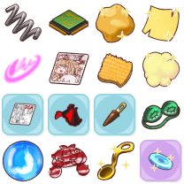
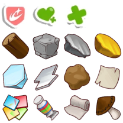
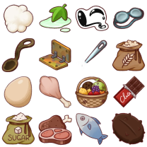
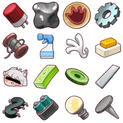

# 生産ラボ 第11段階

第11段階解放後の実データです。研究内容・必要数・所要時間と素材合計は、2026年10月23日に[トリッカル・もちもちほっペ大作戦 Wiki*「生産ラボ」](https://wikiwiki.jp/thetrickal/%E7%94%9F%E7%94%A3%E3%83%A9%E3%83%9C)の第11～第12段階を確認しました。

## 研究内容

| 研究内容 | 研究材料 | 個数（括弧内は総数） | ゴールド | 時間 |
| --- | --- | ---: | ---: | ---: |
| 次元の衝突遺物の選択回数1増加 | 感性コア | 12 | 250k | 12時間 |
| エーリアスフロンティアの実体のコイン10個追加 | 金の匙 | 12 | 250k | 6時間 |
| 遺物カード管理スロット1個追加 | 徹夜アイマスク | 12 | 250k | 6時間 |
| 時間ごとのバトルジェム獲得量2増加 | 感性コア | 12 | 250k | 6時間 |
| 平日農場ログインゴールド収穫量300増加 | 金の匙 | 12 | 250k | 6時間 |
| 平日農場ログインニンジン収穫量3増加 | 徹夜アイマスク | 12 | 250k | 6時間 |
| 物理攻撃力増加・物理防御力増加 | キャラのハンコ | 12（192） | 30k | 1時間 |
| 魔法攻撃力増加 | 感性コア | 12（96） | 30k | 1時間 |
| 魔法防御力増加 | 金の匙 | 12（96） | 30k | 1時間 |
| HP増加 | 徹夜アイマスク | 12（96） | 30k | 1時間 |
| 進軍開始時コイン5増加 | 感性コア | 12 | 110k | 6時間 |

括弧内は同じ研究をすべて進める場合の合計です。

## 最終素材の合計

| 素材 | 必要数 |
| --- | ---: |
| サラサラの鉄粉 | 2,052個 |
| パリパリの金箔 | 792個 |
| 再生プラスチック | 1,908個 |
| 銅の匙 | 1,080個 |
| 睡眠アイマスク | 120個 |
| 固い石 | 0個 |
| やわらか粘土 | 1,920個 |
| 曲がったもの | 1,152個 |

## 第11段階で追加された加工経路

| 作成物 | 必要素材 |
| --- | --- |
| キャラのハンコ 1個 | こねこね粘土 1個 + 手形 3個 |
| こねこね粘土 1個 | EGOブロック 2個 + やわらか粘土 1個 |
| EGOブロック 1個 | 曲がったもの 3個 |
| 手形 1個 | やわらか粘土 3個 |

キャラのハンコ1個の最終換算は、曲がったもの6個とやわらか粘土10個です。1研究ではキャラのハンコを12個使うため、曲がったもの72個とやわらか粘土120個が必要です。
