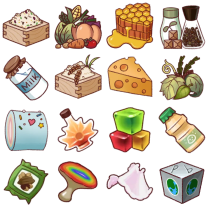

# 生産ラボ 第15段階（予想）

!!! warning "未解放段階の予想"
    第15段階の実データではありません。2026年10月23日に確認した第11・12段階の実測値から、同じ研究構成と増加則が続く場合を計算しています。実装時に研究内容・個数・費用・時間が変わる可能性があります。

## 予想方法

第11段階では研究1回あたりの基準個数が12個、第12段階では15個でした。以後も段階ごとに3個増えると仮定し、第15段階の基準個数を24個とします。

| 研究材料 | 第11段階（実測） | 第12段階（実測） | 第15段階（予想） | 計算 |
| --- | ---: | ---: | ---: | --- |
| 感性コア | 132個 | 165個 | 264個 | 基準個数×11 |
| 金の匙 | 120個 | 150個 | 240個 | 基準個数×10 |
| 徹夜アイマスク | 120個 | 150個 | 240個 | 基準個数×10 |
| キャラのハンコ | 192個 | 240個 | 384個 | 基準個数×16 |

感性コアは通常研究3回分と魔法攻撃力研究8セット分、金の匙・徹夜アイマスクは通常研究2回分と能力研究8セット分、キャラのハンコは物理攻撃力・物理防御力研究の合計16セット分として計算しています。研究効果、ゴールド、時間は実測2段階だけでは確定できないため予想しません。

## 1個あたりの最終換算

| 研究材料 | 最終素材への換算 |
| --- | --- |
| 感性コア 1個 | パリパリの金箔 6個 + サラサラの鉄粉 1個 + 再生プラスチック 9個 |
| 金の匙 1個 | 再生プラスチック 6個 + サラサラの鉄粉 1個 + 銅の匙 9個 |
| 徹夜アイマスク 1個 | サラサラの鉄粉 15個 + 睡眠アイマスク 1個 |
| キャラのハンコ 1個 | 曲がったもの 6個 + やわらか粘土 10個 |

## 第15段階の最終素材予想

| 素材 | 数量 |
| --- | ---: |
| サラサラの鉄粉 | 4,104個 |
| パリパリの金箔 | 1,584個 |
| 再生プラスチック | 3,816個 |
| 銅の匙 | 2,160個 |
| 睡眠アイマスク | 240個 |
| 固い石 | 0個 |
| やわらか粘土 | 3,840個 |
| 曲がったもの | 2,304個 |

## 中間素材の必要数予想

| 中間素材 | 必要数 | 内訳 |
| --- | ---: | --- |
| MUSIMチップ | 264個 | 感性コア264個分 |
| 柔らか金属 | 1,272個 | 感性コア用792個 + バッテリーパック用480個 |
| バッテリーパック | 240個 | 金の匙240個分 |
| 曲がった針金 | 720個 | 金の匙240個分 |
| S字半導体 | 240個 | 徹夜アイマスク240個分 |
| 地球から来た鉛 | 1,200個 | 徹夜アイマスク240個分 |
| こねこね粘土 | 384個 | キャラのハンコ384個分 |
| EGOブロック | 768個 | こねこね粘土384個分 |
| 手形 | 1,152個 | キャラのハンコ384個分 |
